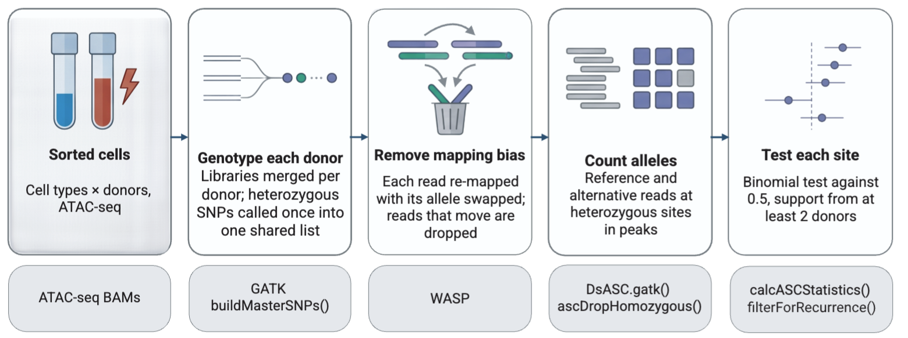

These are the projects I'm working on now. Papers that are already out are on the [Publications](/publications/) page, and install instructions for the packages are under [Software](/software/).

## Immune-cell epigenomes after viral and chemical exposure

*Primary PhD project. First-author preprint, 2025.*

We profiled human immune cells with multimodal single-cell assays and compared cells from people exposed to viruses or chemicals with unexposed cells. I ask which regulatory regions gain or lose accessibility and methylation after exposure, and in which cell types. An earlier part of this work, on chromatin accessibility in peripheral blood cells after pathogen exposure, was a poster at RECOMB 2023.

## methylTFR

*R package. bioRxiv preprint, 2026, under review. [Code](https://github.com/EpigenomeInformatics/methylTFR) · [Preprint](https://doi.org/10.64898/2026.09.29.755279)*

methylTFR quantifies transcription-factor activity from DNA methylation data. Given methylation profiles, it returns an activity score per transcription factor, so differences between samples or cell types can be read as differences in regulators instead of in individual CpGs.

## ARTEMIS

*Python, PyTorch Geometric. Manuscript in preparation. [Repository](https://github.com/EpigenomeInformatics/ARTEMIS)*

ARTEMIS is a graph neural network (GATv2 with skip connections) that predicts cell type from methylation signatures. Its graph is built from known TF–TF interactions, so the attention weights point to the transcription factors and interactions that drove each prediction. I am the sole developer.

## ChrAccR

*R package. First-author manuscript in preparation. [Code](https://github.com/EpigenomeInformatics/ChrAccR)*

ChrAccR analyses chromatin accessibility (ATAC-seq) data from single cells and bulk samples in one memory-efficient framework, from processing and quality control to downstream analysis.

### Allele-specific chromatin accessibility

At a heterozygous SNP, both alleles sit in the same nucleus and in the same ATAC-seq library. If one allele collects more reads than the other, the variant itself changes accessibility. I added a module to ChrAccR that finds these sites. It stores reference and alternative read counts in a `DsASC` object, with one row per SNP and one column per sample.

*The ASC workflow in ChrAccR. The filter for sites supported by at least two donors in the last box is optional.*

1. **Genotype each donor.** Libraries are merged per donor and heterozygous SNPs are called with GATK. `buildMasterSNPs()` combines the donors into one shared SNP list.
2. **Remove mapping bias.** Reads carrying the alternative allele map slightly worse, which shifts every site towards the reference. WASP re-maps each read with its allele swapped and drops the reads that move.
3. **Count alleles.** `DsASC.gatk()` counts reference and alternative reads at heterozygous SNPs in peaks. `ascDropHomozygous()` masks sites that show only one allele in a donor, which are usually genotyping errors.
4. **Test each site.** `calcASCStatistics()` runs a two-sided binomial test against 0.5 per site and sample, with Benjamini-Hochberg correction within each sample. `filterForRecurrence()` can then keep the sites found in at least two donors.

After testing, `ascSharing()` estimates how many imbalanced sites stay imbalanced in another condition or cell type, and `ascMotifPreference()` checks whether the less accessible allele is the one with the weaker transcription-factor motif. The [vignette](https://epigenomeinformatics.github.io/ChrAccR/articles/allelespec.html) runs the full analysis on example data from the immune cell atlas of Calderon et al. (2019). The functions are in the `alleleSpec` branch of ChrAccR.

## CD8 T-cell exhaustion

*Co-supervised MSc thesis.*

We integrate single-cell multiome atlases from several viral cohorts to characterise CD8 T-cell exhaustion at acute, chronic and tumoral stages.
